  

  
  
  
  
  
  

---

# 📑 Awesome PDF Editor & Converter

> **A comprehensive, SEO-optimized, community-curated directory of top-tier SaaS platforms and open-source GitHub projects for PDF editing, format conversion, optical character recognition (OCR), electronic signatures, and offline document processing.**

Whether you require a full enterprise commercial suite, a self-hosted Dockerized web app for private documents, or an embedded programming library to manipulate PDF streams in Python, Go, JavaScript, or Java — this directory maps the complete PDF software ecosystem.

---

## 📑 Table of Contents

- [🌐 Sector Overview & Market Dynamics](#-sector-overview--market-dynamics)
- [🏢 SaaS & Commercial PDF Platforms](#-saas--commercial-pdf-platforms)
- [💻 Open-Source GitHub Projects](#-open-source-github-projects)
- [🎯 Choosing the Right PDF Solution](#-choosing-the-right-pdf-solution)
- [❓ Frequently Asked Questions (SEO / FAQ)](#-frequently-asked-questions-seo--faq)
- [🤝 How to Contribute](#-how-to-contribute)
- [⭐ Star History](#-star-history)
- [💖 Support & Sponsoring](#-support--sponsoring)
- [⚠️ Disclaimer](#️-disclaimer)

---

## 🌐 Sector Overview & Market Dynamics

The global PDF editor and converter software market is estimated at **$2.8 billion in 2024**, projected to reach **$6.2 billion by 2030** at an annual compound growth rate (CAGR) of **9.2%**, propelled by enterprise digital transformations, paperless regulatory compliance, cloud e-signatures, and AI-assisted document workflows.

The market is **moderately concentrated at the enterprise level**, where **Adobe Acrobat** commands dominant market share alongside well-capitalized SaaS contenders like **Foxit**, **Nitro**, and **airSlate (pdfFiller)**; however, the utility and developer tier remains **highly fragmented**, characterized by hundreds of niche web converters, browser-local JavaScript tools, and an explosive rise in self-hosted, privacy-first open-source solutions driven by strict data governance mandates (such as GDPR, HIPAA, and SOC 2).

---

## 🏢 SaaS & Commercial PDF Platforms

The following commercial SaaS and desktop platforms deliver turnkey PDF editing, document conversion, automated OCR, and digital signature workflows.  
*Table sorted in descending order by estimated company size (market valuation / annual revenue).*

| 🏢 Platform | 📊 Company Size (Valuation / Revenue) | 💰 Starting Price | 🎁 Free Tier / Trial Limits | 🎯 Core Strengths & Key Capabilities |
| :--- | :--- | :--- | :--- | :--- |
| [**Adobe Acrobat Pro**](https://www.adobe.com/acrobat.html) | **$214 Billion Market Cap** / $21.5B Rev (Adobe Inc.) | **$12.99 / mo** (Standard, annual commitment) or **$19.99 / mo** (Pro, annual commitment) | **7-day free trial** (unlimited access to all Pro editing, OCR, and e-sign features; credit card required; auto-bills unless canceled); Acrobat Reader has **free forever plan** with basic viewing, annotations, and up to 2 free document conversions/signatures per month. | Industry reference standard; full bidirectional text reflow, enterprise security, preflight print preparation, and automated form recognition. |
| [**Foxit PDF Editor**](https://www.foxit.com/pdf-editor/) | **$1.8 Billion Market Cap** / $95M Rev (Foxit Software) | **$12.50 / mo** ($149.99/year for PDF Editor Cloud & Desktop) | **14-day free trial** (full access to editing, redaction, and OCR tools; documents exported during trial include watermarks; no credit card required); Foxit PDF Reader is **free forever** for viewing and basic markups. | Rapid rendering engine, lightweight desktop footprint, Microsoft 365 / SharePoint enterprise integration, and robust redaction. |
| [**pdfFiller**](https://www.pdffiller.com/) | **$1.25 Billion Valuation** / $150M+ ARR (airSlate, Inc.) | **$8.00 / mo** (Basic plan, billed annually at $96/year) | **30-day free trial** (unrestricted access to cloud PDF editor, form fields, and 1 signature workflow; credit card required to activate trial). | Cloud-native browser experience, interactive fillable form builder, secure contract signing, and automated document generation. |
| [**Nitro Pro**](https://www.gonitro.com/) | **$350 Million Valuation** / $75M ARR (Nitro Software) | **$14.16 / mo** ($169.99/year billed annually) or **$179.99** one-time perpetual license | **14-day free trial** (full access to desktop PDF editor, conversion, OCR, and unlimited electronic signatures; no credit card required). | Perpetual license option for teams rejecting subscription lock-in, familiar Microsoft Office-style ribbon UI, and fast batch document conversions. |
| [**Smallpdf**](https://smallpdf.com/) | **$120 Million Valuation** / $30M ARR (Smallpdf AG) | **$9.00 / mo** (Pro plan, billed annually at $108/year) | **Free forever plan** limited to **2 document tasks per day**, standard single-file processing speed, and access to 21 browser-based utility tools. | Ultra-intuitive drag-and-drop web UI, mobile scanner integration, and fast compression/conversion algorithms for non-technical users. |
| [**iLovePDF**](https://www.ilovepdf.com/) | **$80 Million Valuation** / $22M ARR (iLovePDF Inc.) | **$4.00 / mo** (Premium plan, billed annually at $48/year) | **Free forever plan** limited to **3 tasks per hour**, max file size of **15 MB per file**, and maximum 3 files per batch operation. | Cost-effective web and mobile tools, high-speed batch processing, and offline desktop application access included with premium plans. |
| [**Sejda PDF**](https://www.sejda.com/) | **$45 Million Valuation** / $12M ARR (Sejda B.V.) | **$5.00 / week** (Web Week pass) or **$7.50 / mo** (Web Monthly) | **Free forever plan** limited to **3 tasks per day**, maximum document size of **200 pages or 50 MB**, and files stored for up to 2 hours before deletion. | In-place PDF text and paragraph editing directly in the browser, fillable form creation, and zero-registration temporary week passes. |
| [**PDF24 Creator**](https://www.pdf24.org/) | **$8 Million Valuation** / $3M ARR (Geek Software GmbH) | **$0.00 / mo** (100% Free freeware desktop suite; optional PDF24 Fax starts at $2.20/mo) | **Free forever desktop suite** with zero functional limits on merging, splitting, compressing, OCR, page reordering, and virtual printer; Fax service includes **5 free test pages**. | Generous 100% free Windows desktop utility with integrated virtual printer driver, offline Tesseract OCR, and zero cloud uploads. |

---

## 💻 Open-Source GitHub Projects

Explore the most prominent open-source repositories for self-hosted PDF management, web viewers, command-line utilities, and developer libraries.  
*All open-source projects below are sorted in descending order by GitHub stargazers count, with real-time Stars_Badges linking directly to each repository's stargazers page.*

---

### 1. [Stirling-PDF](https://github.com/Stirling-Tools/Stirling-PDF) 
- **Primary Category**: 🐳 Self-Hosted PDF Management Suite
- **Language / Tech Stack**: Java, Spring Boot, Docker, Thymeleaf, Tesseract OCR, LibreOffice
- **License**: GPL-3.0 / Open-Core
- **Overview**: The undisputed #1 open-source PDF toolkit on GitHub. Packages over **50+ PDF operations** into a single, beautifully designed Docker container: merge, split, rotate, convert to/from Office formats (via LibreOffice), compress, repair, OCR (via Tesseract), redact, sign (Stirling Sign), watermark, add/remove passwords, and compare documents.
- **Privacy Posture**: Files are processed either in-memory or in ephemeral storage and automatically deleted immediately after task execution. Desktop apps exist for Windows, macOS, and Linux.

---

### 2. [PDF.js](https://github.com/mozilla/pdf.js) 
- **Primary Category**: 🌐 Web & Browser PDF Rendering Engine
- **Language / Tech Stack**: JavaScript, HTML5 Canvas, WebGL
- **License**: Apache-2.0
- **Overview**: Mozilla’s flagship general-purpose, web-standards-compliant platform for parsing and rendering PDFs directly in browser DOM canvas. Powers built-in PDF viewing across Mozilla Firefox and hundreds of web applications worldwide.
- **Privacy Posture**: 100% client-side execution; documents never leave the user's browser sandbox.

---

### 3. [OCRmyPDF](https://github.com/ocrmypdf/OCRmyPDF) 
- **Primary Category**: 🔍 Command-Line OCR & PDF/A Archival Tool
- **Language / Tech Stack**: Python, Tesseract OCR, Ghostscript, Unpaper
- **License**: MPL-2.0
- **Overview**: Adds an optical character recognition (OCR) text layer to scanned PDF files, transforming flat image scans into searchable, selectable documents. Enforces PDF/A validation, corrects skew angles, cleans up artifacts, and retains original raster graphics intact.
- **Privacy Posture**: Completely local CLI execution; ideal for automated backend scanning pipelines.

---

### 4. [SumatraPDF](https://github.com/sumatrapdfreader/sumatrapdf) 
- **Primary Category**: ⚡ Ultra-Fast Desktop PDF Reader & Viewer
- **Language / Tech Stack**: C++, C, MuPDF engine
- **License**: AGPL-3.0 / GPL-3.0
- **Overview**: Renowned for minimalist design and blistering start-up performance on Windows. Supports PDF, eBook (ePub, Mobi), XPS, DjVu, CHM, and comic book formats (CBZ and CBR).
- **Privacy Posture**: 100% offline desktop application with zero network calls or tracking.

---

### 5. [Xournal++](https://github.com/xournalpp/xournalpp) 
- **Primary Category**: ✍️ PDF Annotation, Handwriting & Digital Ink
- **Language / Tech Stack**: C++, GTK 3, Poppler
- **License**: GPL-2.0
- **Overview**: An open-source handwriting notetaking and document sketching suite with first-class PDF annotation. Allows users to highlight, draw freehand vector paths, type notes, insert LaTeX formulas, record audio notes, and sign PDF pages on Linux, macOS, and Windows.
- **Privacy Posture**: Fully offline desktop program.

---

### 6. [pdfmake](https://github.com/bpampuch/pdfmake) 
- **Primary Category**: 📜 Declarative Client/Server PDF Generation
- **Language / Tech Stack**: JavaScript, Node.js, Web Worker
- **License**: MIT
- **Overview**: Client/server side PDF printing in pure JavaScript using a declarative document definition syntax. Features automatic page wrapping, complex nested tables, custom fonts, vector graphics, and image insertion.
- **Privacy Posture**: Runs on client browser or internal Node.js backend.

---

### 7. [PyMuPDF](https://github.com/pymupdf/PyMuPDF) 
- **Primary Category**: 🐍 High-Performance Python PDF Toolkit
- **Language / Tech Stack**: Python, C, MuPDF
- **License**: AGPL-3.0 / Commercial
- **Overview**: One of the fastest Python libraries for PDF inspection, rendering, text/image extraction, and modifications. Provides full access to MuPDF capabilities: page rasterization, font embedding, search, redact, and OCR integration.
- **Privacy Posture**: Runs in local Python execution environments.

---

### 8. [PDFKit](https://github.com/foliojs/pdfkit) 
- **Primary Category**: 🖌️ Programmatic Vector PDF Generation
- **Language / Tech Stack**: JavaScript, Node.js
- **License**: MIT
- **Overview**: A versatile JavaScript PDF generation library for Node.js and modern browsers. Supports complex vector graphics, line wrapping, font subsetting, encrypted files, and PDF annotations via a chainable canvas-style API.
- **Privacy Posture**: Pure code library, runs in local runtime.

---

### 9. [pypdf](https://github.com/py-pdf/pypdf) 
- **Primary Category**: 🐍 Pure-Python Document Manipulation
- **Language / Tech Stack**: Pure Python (no external dependencies)
- **License**: BSD-3-Clause
- **Overview**: The gold standard pure-Python library capable of splitting, merging, cropping, transforming pages, extracting text and images, filling form fields, and decrypting/encrypting PDF documents.
- **Privacy Posture**: Runs entirely in local Python runtime with zero external binary dependencies.

---

### 10. [WeasyPrint](https://github.com/Kozea/WeasyPrint) 
- **Primary Category**: 🎨 HTML & CSS to PDF Visual Converter
- **Language / Tech Stack**: Python, Pango, Cairo
- **License**: BSD-3-Clause
- **Overview**: The "awesome document factory" designed to transform HTML documents and CSS stylesheets into book-quality printable PDFs. Adheres closely to W3C print specifications, multi-column layouts, page counters, and bookmarks.
- **Privacy Posture**: Local generation without headless browser bloat.

---

### 11. [pdfcpu](https://github.com/pdfcpu/pdfcpu) 
- **Primary Category**: ⚡ High-Speed Go PDF Processor & CLI
- **Language / Tech Stack**: Go (Golang)
- **License**: Apache-2.0
- **Overview**: A high-performance PDF processing engine and command-line utility written in Go. Delivers ultra-fast validation, page optimization, watermarking, stamping, grid imposition, page slicing, attachment extraction, and encryption.
- **Privacy Posture**: Standalone compiled single binary with zero external runtime dependencies.

---

### 12. [pdf-lib](https://github.com/Hopding/pdf-lib) 
- **Primary Category**: 🌐 Client/Server JavaScript PDF Creator & Editor
- **Language / Tech Stack**: TypeScript, JavaScript
- **License**: MIT
- **Overview**: Create and modify PDF documents in any JavaScript environment: web browsers, Node.js, Deno, and React Native. Supports drawing text, vector paths, images, copying pages between documents, and interactive AcroForm form filling.
- **Privacy Posture**: Completely client-side or server-side without native dependencies.

---

### 13. [pdfarranger](https://github.com/pdfarranger/pdfarranger) 
- **Primary Category**: 🧩 Graphical Page Organizer & Layout Editor
- **Language / Tech Stack**: Python, GTK 3, pikepdf / QPDF
- **License**: GPL-3.0
- **Overview**: A lightweight desktop GUI application to visually merge, split, reorder, rotate, crop, duplicate, and delete PDF pages with an intuitive thumbnail interface.
- **Privacy Posture**: 100% offline desktop application for Linux and Windows.

---

### 14. [QPDF](https://github.com/qpdf/qpdf) 
- **Primary Category**: 🔧 Content-Preserving PDF Transformation Engine
- **Language / Tech Stack**: C++
- **License**: Apache-2.0
- **Overview**: The foundational command-line program and C++ library that powers numerous PDF tools (including pdfarranger and cups-filters). Specializes in linearizing (web optimization), encrypting, decrypting, and structural transformations without modifying underlying raster or vector contents.
- **Privacy Posture**: Local compiled C++ utility.

---

### 15. [PDFsam Basic](https://github.com/torakiki/pdfsam) 
- **Primary Category**: ✂️ Desktop PDF Splitter & Merger
- **Language / Tech Stack**: Java, JavaFX, Sejda SDK
- **License**: AGPL-3.0
- **Overview**: Mature desktop tool for splitting documents by page numbers, bookmarks, or file size, merging files in arbitrary order, rotating pages, and extracting specific page ranges.
- **Privacy Posture**: All operations occur locally on the user's workstation.

---

### 16. [LibreOffice Draw](https://github.com/LibreOffice/core) 
- **Primary Category**: 📐 Vector Document & Direct PDF Editor
- **Language / Tech Stack**: C++, LibreOffice Core Engine
- **License**: MPL-2.0
- **Overview**: Opens foreign PDF documents as graphical vector files, allowing direct manipulation of text snippets, image repositioning, annotation, and export back to clean PDF or Office formats.
- **Privacy Posture**: Offline desktop suite.

---

### 17. [OpenPDF](https://github.com/LibrePDF/OpenPDF) 
- **Primary Category**: ☕ Java PDF Generation & Manipulation Library
- **Language / Tech Stack**: Java
- **License**: LGPL-2.1 / MPL-2.0
- **Overview**: A widely used, permissively licensed Java library for creating and inspecting PDF files. Maintained fork of original iText 4, resolving critical bugs and ensuring modern JDK compatibility.
- **Privacy Posture**: Embedded code library; runs within your secure Java application boundary.

---

### 18. [Apache PDFBox](https://github.com/apache/pdfbox) 
- **Primary Category**: ☕ Enterprise Java PDF Toolkit
- **Language / Tech Stack**: Java (Apache Foundation)
- **License**: Apache-2.0
- **Overview**: The flagship Java tool for PDF document manipulation: creation, text extraction, page splitting, merging, digital signing, AcroForm data population, and conversion to images or pre-press formats.
- **Privacy Posture**: Enterprise-ready Java library with zero third-party calls.

---

### 19. [PDF4QT](https://github.com/JakubMelka/PDF4QT) 
- **Primary Category**: ⚖️ Qt-Based PDF Editor & Visual Comparison Tool
- **Language / Tech Stack**: C++, Qt 6
- **License**: MIT
- **Overview**: Open-source desktop editor featuring visual document diffing (side-by-side and overlay comparison), layout rearrangement, encryption, and color separations.
- **Privacy Posture**: 100% offline desktop application for Linux and Windows.

---

### 20. [LocalPDF Studio](https://github.com/Alinur1/LocalPDF_Studio) 
- **Primary Category**: 🔒 100% Offline Browser/Desktop Privacy Toolkit
- **Language / Tech Stack**: HTML5, JavaScript, WebAssembly, PDF.js
- **License**: AGPL-3.0
- **Overview**: Privacy-first offline toolkit that performs document merging, page extraction, watermarking, grayscale conversion, form field generation, and local OCR without sending a single byte to external servers.
- **Privacy Posture**: Completely sandboxed offline execution in client browser or Electron app.

---

### 21. [PDFApps](https://github.com/nelsonduarte/PDFApps) 
- **Primary Category**: 🖥️ Subscription-Free Offline Desktop PDF Editor
- **Language / Tech Stack**: Python, PySide6 (Qt 6), PyMuPDF, pypdf, Tesseract OCR
- **License**: GPL-3.0
- **Overview**: An offline, subscription-free desktop manager and editor for Windows, macOS, and Linux. Supports continuous scroll page editing, handwritten and drawn signatures, sequential pipeline mode, automated Tesseract OCR detection, and redaction.
- **Privacy Posture**: Zero telemetry, zero cloud storage; operates strictly on local disk.

---

## 🎯 Choosing the Right PDF Solution

| Use Case Requirement | Recommended Solution | Deployment Style | Key Advantage |
| :--- | :--- | :--- | :--- |
| **Self-Hosted Complete Replacement for Acrobat** | [**Stirling-PDF**](https://github.com/Stirling-Tools/Stirling-PDF) | Docker / Self-Hosted Web | 50+ operations in one unified interface with API support. |
| **100% Offline Desktop Editing with Signatures** | [**PDFApps**](https://github.com/nelsonduarte/PDFApps) or [**LocalPDF Studio**](https://github.com/Alinur1/LocalPDF_Studio) | Native Desktop (Qt / WebAssembly) | Zero external server communication; safe for confidential contracts. |
| **Batch OCR & PDF/A Long-Term Archival** | [**OCRmyPDF**](https://github.com/ocrmypdf/OCRmyPDF) | Command-Line (CLI) / Docker | Automatic deskewing, text layer embedding, and PDF/A verification. |
| **High-Performance Python Data Extraction** | [**PyMuPDF**](https://github.com/pymupdf/PyMuPDF) or [**pypdf**](https://github.com/py-pdf/pypdf) | Python Library | Blazing speed, minimal overhead, and pure-Python portability. |
| **Client-Side Web PDF Manipulation** | [**pdf-lib**](https://github.com/Hopding/pdf-lib) or [**PDF.js**](https://github.com/mozilla/pdf.js) | JavaScript / Browser DOM | Interactive in-browser editing and rendering without backend roundtrips. |
| **Enterprise Standard & Turnkey Cloud Workflows** | [**Adobe Acrobat Pro**](https://www.adobe.com/acrobat.html) or [**Foxit PDF Editor**](https://www.foxit.com/pdf-editor/) | Commercial SaaS / Desktop | Full text reflow, preflight tools, and certified cloud e-signatures. |

---

## ❓ Frequently Asked Questions (SEO / FAQ)

### 1. How can I edit and convert PDFs for free without uploading sensitive files to the cloud?
To protect sensitive financial records, medical documents, or legal contracts, use **offline-first or self-hosted solutions** such as **[Stirling-PDF](https://github.com/Stirling-Tools/Stirling-PDF)** (run via Docker on your local network), **[PDFApps](https://github.com/nelsonduarte/PDFApps)**, or **[LocalPDF Studio](https://github.com/Alinur1/LocalPDF_Studio)**. These tools process your files directly inside your machine's CPU and memory, ensuring zero document telemetry or third-party server exposure.

### 2. What is the best free open-source alternative to Adobe Acrobat Pro?
For a web-based, multi-user environment, **[Stirling-PDF](https://github.com/Stirling-Tools/Stirling-PDF)** is the most versatile alternative, offering merge, split, convert, OCR, watermark, and digital signature capabilities. For desktop line-by-line text and vector editing, **[LibreOffice Draw](https://github.com/LibreOffice/core)** or **[PDFApps](https://github.com/nelsonduarte/PDFApps)** serve as effective offline choices.

### 3. How do I make scanned PDF files searchable?
You can run automated OCR pipelines using **[OCRmyPDF](https://github.com/ocrmypdf/OCRmyPDF)** on the command line or use Stirling-PDF's embedded Tesseract engine. This embeds a searchable invisible text layer behind your scanned images while preserving the original layout and image resolution.

### 4. Which programming libraries should I use to generate or modify PDFs programmatically?
- **Python**: Use **[PyMuPDF](https://github.com/pymupdf/PyMuPDF)** for speed and rendering; use **[pypdf](https://github.com/py-pdf/pypdf)** for pure-Python portability.
- **JavaScript / TypeScript**: Use **[pdf-lib](https://github.com/Hopding/pdf-lib)** for in-browser editing; use **[pdfmake](https://github.com/bpampuch/pdfmake)** or **[PDFKit](https://github.com/foliojs/pdfkit)** for document generation.
- **Go**: Use **[pdfcpu](https://github.com/pdfcpu/pdfcpu)** for high-throughput batch operations.
- **Java**: Use **[Apache PDFBox](https://github.com/apache/pdfbox)** or **[OpenPDF](https://github.com/LibrePDF/OpenPDF)**.

---

## 🤝 How to Contribute

Contributions are welcome and appreciated! To add a new platform or update existing benchmarks:

1. **Fork** this repository.
2. Create a new descriptive branch (`git checkout -b feature/add-new-pdf-tool`).
3. Edit `README.md`:
   - Follow the established table or card formatting.
   - For SaaS tools: provide exact starting price tiers, verified company size, and specific free tier / trial terms.
   - For open-source tools: include the repository link, Stars_Badge linked to stargazers, license, tech stack, and privacy posture.
4. **Commit** your changes with clear messages (`git commit -m "Add New-PDF-Tool to open-source section"`).
5. **Push** to your fork (`git push origin feature/add-new-pdf-tool`).
6. Submit a **Pull Request (PR)** with a summary of the additions.

---

## ⭐ Star History

---

## 💖 Support & Sponsoring

Thank you for visiting and supporting the **Awesome PDF Editor & Converter** ecosystem! If this curated guide helped you discover the right tool or saved you hours of research, please consider supporting the project:

- ⭐ **Star this repository** to improve discoverability for other developers and teams.
- 🍴 **Fork and share** with colleagues, developers, and privacy advocates.
- 📢 **Join our community** on [Discord](https://discord.gg/jc4xtF58Ve) and check out our other awesome collections at [Awesome-Awesome-Awesome](https://github.com/ishandutta2007/Awesome-Awesome-Awesome).
- ☕ **Sponsor the maintainer** to fund continuous directory maintenance, tool testing, and benchmark updates:

  

👉 **Support directly via [GitHub Sponsors Dashboard](https://github.com/sponsors/ishandutta2007)**

---

## ⚠️ Disclaimer

- This repository is a **community-curated directory** intended for informational and educational purposes. Mention of commercial products or open-source projects does not constitute a formal endorsement.
- SaaS pricing, trial periods, and terms of service may change over time; always confirm directly with the vendor's official pricing page.
- Self-hosted open-source software requires proper configuration, access controls, and resource allocation (e.g., Stirling-PDF recommends 2–4 GB RAM for high-load OCR and LibreOffice conversions).

---

  Curated with ❤️ by <a href="https://github.com/ishandutta2007">Ishan Dutta</a> and the global open-source community.

